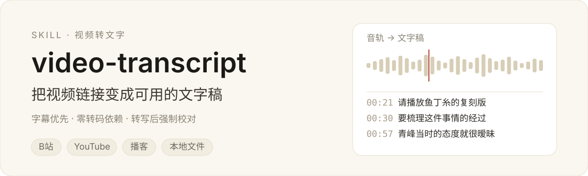
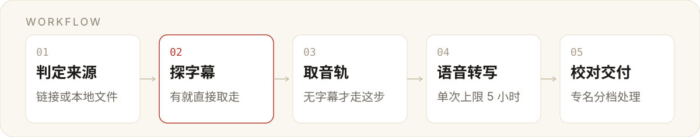

<p align="center">
  
</p>

<h3 align="center">给一个视频链接，拿回一份能用的文字稿</h3>

<p align="center">
先看有没有现成字幕，没有才开转写；转完必须校对，不把机器识别当成逐字核对。
</p>

大部分「视频转文字」的做法是一上来就把音频丢给语音识别。结果是人名、厂牌、数字全错，却读起来很顺——**这种顺，比错更危险**。这个 skill 把顺序倒过来：先找字幕（直取，准确率最高），找不到才转写，转完按错误类型分档处理，最后才交付。

安装只要一句话，把仓库地址发给你的 agent 就行：[一键安装](#一键安装把这句话发给你的-agent)。

## 真实输出

一条命令完成取源判断与音轨落地：

```bash
python scripts/bili_fetch.py "https://www.bilibili.com/video/BV1Ds4y1n74K/"
```

```text
BVID=BV1Ds4y1n74K
TITLE=苏打绿为什么要重录专辑？一个视频让你搞懂音乐版权
DURATION=1019
UPLOADER=呆若木一在此
PUBDATE=2023-03-23
PAGES=1
NOTE=该视频有 AI 字幕但需登录，当前未取到。若能提供 SESSDATA，用 --cookie 重跑，准确率远高于语音转写。
AUDIO=...\audio_p1.m4a
AUDIO_MB=10.7
META=...\meta.json
```

注意那行 `NOTE`：它说的是**有字幕但没权限**，不是没字幕。这类判断做错，整条链路就会走弯路——这是这个 skill 存在的主要理由。音轨转写并校对后，产出两份文件：

- `苏打绿音乐版权_视频文字稿.md` — 元信息、摘要、时间轴、带时间戳全文
- `苏打绿音乐版权_视频文字稿_纯文本.txt` — 去时间戳，57 段，约 5600 字

## 工作流

<p align="center">
  
</p>

第 2 步决定后面全部成本：字幕是直取，转写是推断。能取就别转。

## 校对分三档，不是全改

语音识别的错有规律，按类型过一遍比通读三遍有效。规则写在 [`references/asr-proofreading.md`](./references/asr-proofreading.md)，速查：

| 档位 | 判据 | 动作 | 实例 |
| --- | --- | --- | --- |
| 必改 | 有确凿依据，专名唯一 | 直接改正并记入清单 | 林伟哲 → 林暐哲；鱼定糸 → 鱼丁糸 |
| 建议改 | 高置信但未核实 | 改后标「疑为」 | 池塘影业 → 池堂影业（疑为） |
| 只标注 | 听不清、抢话、方言 | 保留原样加 `（音）` | — |

判断依据不足就降一档。**改错了比不改更糟**，用户核对时会把错误当成事实。

## 一键安装：把这句话发给你的 agent

```text
安装这个技能：https://github.com/Canyon-Li/video-transcript
克隆到你的技能目录，跑一下自检，装完告诉我路径。
```

一次真实往返长这样：

> **你**：安装这个技能 https://github.com/Canyon-Li/video-transcript
>
> **agent**：已克隆到 `~/.workbuddy/skills/video-transcript`，自检通过——`SKILL.md` 能解析，两个脚本在位。重开一次会话就能触发。

agent 实际做四步：克隆 → 跑 `install.py --check --json` → 读返回的 JSON → 按结果汇报。完整契约写在 [`INSTALL.md`](./INSTALL.md)，agent 读它一个文件就够，不需要从这份 README 里猜。

技能目录按客户端取：WorkBuddy 是 `~/.workbuddy/skills`，Claude Code 是 `~/.claude/skills`。

### 不用 agent 也行

```bash
git clone --depth 1 https://github.com/Canyon-Li/video-transcript.git ~/.workbuddy/skills/video-transcript
```

### 自检

```bash
python ~/.workbuddy/skills/video-transcript/scripts/install.py --check
```

```text
  技能目录   C:\Users\李生\.workbuddy\skills\video-transcript
  安装方式   目录联接 → \\?\D:\Desktop\git\skills\video-transcript
  SKILL.md   OK  name=video-transcript
  bili_fetch.py         OK
  format_transcript.py  OK

  状态：可用
```

可用的判据是三件事同时成立：目录可达、frontmatter 能解析、两个核心脚本在位。缺一项就退出码 1 并写明原因——**不要只看目录存在就当装好了**。

### 仓库想放在别处

自己维护 clone（比如放在 `D:\git\video-transcript`）时，用目录联接接进来，之后 `git pull` 无需重装：

```powershell
python scripts/install.py --link D:\git\video-transcript
```

Windows 用 junction（不需管理员权限），macOS/Linux 用符号链接，失败才降级为复制。

### 更新与卸载

```bash
python scripts/install.py --update      # git pull --ff-only
python scripts/install.py --uninstall   # 只摘链接，目标仓库不动
```

卸载只移除链接本身。若目标位置是实体目录，会拒绝删除并提示加 `--force-real-dir`——避免把真实仓库连着一起删掉。

### 没有 git

`install.py` 会自动降级为下载 zip 解压，不需要 git 也能装。

## 首次使用

装完重开会话，在对话里直接给链接就会触发：

> 帮我把这个视频的文字提取出来：`https://www.bilibili.com/video/BV...`

手动跑也可以：

```bash
python scripts/bili_fetch.py "<链接>" --out ./_src        # 字幕优先，无字幕下载音轨
python scripts/format_transcript.py ./_src/asr_raw.txt --merge
```

`format_transcript.py` 会打印字数与语速。< 200 字/分钟说明有大段静音或转写遗漏，需要回头查——这是自己发现翻车的最低成本方式。

## 仓库结构

| 路径 | 作用 |
| --- | --- |
| `SKILL.md` | 主流程与四条硬原则 |
| `INSTALL.md` | 给 agent 的安装契约：装哪、怎么验、怎么汇报 |
| `scripts/install.py` | 安装器：克隆 / 联接 / 自检 / 更新 / 卸载，纯标准库 |
| `scripts/bili_fetch.py` | B 站取源：探字幕、下音轨、写 meta，纯标准库 |
| `scripts/format_transcript.py` | ASR / 字幕文本统一格式化，附语速体检 |
| `references/platforms.md` | 各平台取源分诊表与破障命令 |
| `references/asr-proofreading.md` | 校对规则与高频错误清单 |
| `references/deliverable-template.md` | 交付物结构与反例 |
| `assets/readme/` | 本页视觉素材（SVG，可手改） |

## 能做什么，不能做什么

**能做**：B 站字幕直取与音轨转写、YouTube 字幕与音轨、播客直链、本地音视频；输出带时间戳全文、纯文本、SRT、摘要与结构化文档。

**不能做**：

- 会员、付费、登录墙内容——需要 cookie 或本地文件，不硬试
- 抖音、小红书、视频号——反爬严格，建议先下载到本地再给路径
- 单次超过约 1GB / 5 小时——需要按时间切片
- 实时直播同传——这套流程是后处理，不是流式

**质量边界**：转写是语音识别，方言、多人抢话、强背景音下置信度会明显下降。这种情况会明确告知，不会润色成通顺的假象。

---

<p align="center">
<sub>依赖：Python 3 标准库（B 站路径）；无需 ffmpeg 或 yt-dlp。</sub>
</p>
